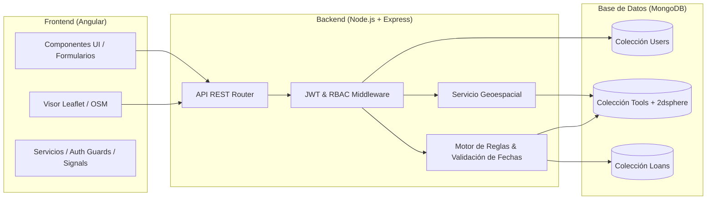
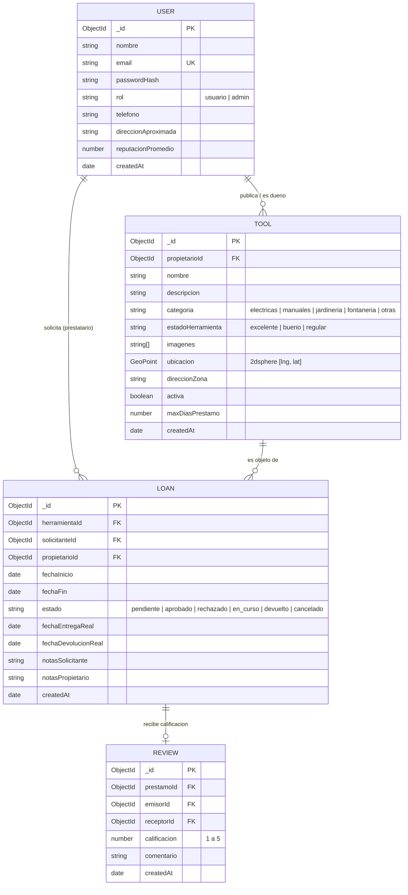

# Tool Library — Biblioteca Comunitaria de Herramientas
## Documento Base de Arquitectura, Requisitos y Modelo de Datos
**Asignatura:** Lenguajes de Programación III  
**Enfoque:** Sostenibilidad, Economía Circular y Desarrollo Web Full Stack

---

## 1. Visión General del Sistema

**Tool Library** es una plataforma web colaborativa orientada a la economía circular. Permite a los miembros de una comunidad registrar, prestar, localizar y reservar herramientas de uso ocasional (bricolaje, jardinería, mecánica, fontanería, etc.), reduciendo el consumo innecesario, el gasto económico y la huella ecológica.



---

## 2. Refinamiento de Requerimientos

### 2.1. Matriz de Requerimientos Funcionales (RF) con Roles Asociados

| ID | Requerimiento Funcional | Rol Principal | Detalle / Criterio de Aceptación |
| :--- | :--- | :--- | :--- |
| **RF01** | Registro y autenticación de usuarios | Invitado / Usuario | Registro con nombre, email único y contraseña cifrada. Login que retorna token JWT. |
| **RF02** | Gestión de perfil y reputación | Usuario | Actualización de datos de contacto, zona/barrio y consulta de historial de valoraciones. |
| **RF03** | Publicación y gestión de herramientas | Propietario | Crear, editar y dar de baja herramientas con fotos, descripción, estado físico y coordenadas geográficas. |
| **RF04** | Catálogo con filtros avanzados | Usuario | Búsqueda textual por nombre/descripción, filtro por categoría y filtro por disponibilidad. |
| **RF05** | Visualización en Mapa Interactivo | Usuario | Marcadores con iconos representativos en Leaflet; popup con resumen de la herramienta y botón de reserva. |
| **RF06** | Búsqueda por proximidad geográfica | Usuario | Cálculo de distancia en radio $N$ km mediante índice `2dsphere` y operador `$near` / `$geoNear`. |
| **RF07** | Calendario de disponibilidad | Usuario | Visualización interactiva de fechas ocupadas y disponibles de cada herramienta. |
| **RF08** | Ciclo de solicitud de préstamos | Solicitante / Propietario | Flujo de estados: `Pendiente` $\rightarrow$ `Aprobada` / `Rechazada` $\rightarrow$ `En Curso` $\rightarrow$ `Devuelta`. |
| **RF09** | Confirmación de entrega y devolución | Propietario | Registro de fecha y hora real de entrega y devolución con verificación de estado del equipo. |
| **RF10** | Historial y trazabilidad de préstamos | Usuario / Admin | Consulta de préstamos activos, pasados y solicitudes pendientes. |
| **RF11** | Notificaciones internas / alertas | Sistema | Alertas en pantalla sobre solicitudes recibidas, vencimientos próximos y devoluciones. |
| **RF12** | Panel de administración y moderación | Administrador | Bloqueo de usuarios con mala conducta, moderación de publicaciones reportadas y métricas globales. |

> [!IMPORTANT]
> **Regla de Negocio Crítica (RN-01: No Solapamiento):**  
> Una herramienta no puede reservarse si el intervalo solicitado $[F_{inicio}, F_{fin}]$ se intersecta con cualquier reserva existente en estado `aprobado` o `en_curso`.  
> Condición matemática de colisión:
> $$\text{Existe colisión si: } (F_{inicio\_nueva} \le F_{fin\_existente}) \land (F_{fin\_nueva} \ge F_{inicio\_existente})$$

---

### 2.2. Requerimientos No Funcionales (RNF)

| ID | Categoría | Especificación Técnica |
| :--- | :--- | :--- |
| **RNF01** | **Seguridad** | Hasheo de contraseñas mediante `bcrypt` (factor de costo mínimo 10). Sanitización contra inyección NoSQL. |
| **RNF02** | **Autenticación** | Tokens JWT con expiración definida (ej. 8 horas) transmitidos mediante el encabezado `Authorization: Bearer <token>`. Interceptores HTTP en Angular. |
| **RNF03** | **Rendimiento** | Consultas geoespaciales y de catálogo con tiempo de respuesta en API $< 500\text{ ms}$ en entorno local / $< 2\text{ s}$ en red estándar. |
| **RNF04** | **Usabilidad** | Diseño Responsive (Mobile-First) con Bootstrap / Angular Material / Tailwind CSS, garantizando navegación fluida en dispositivos móviles. |
| **RNF05** | **Privacidad** | La ubicación en el mapa muestra un **radio aproximado o barrio** del propietario, revelando la dirección exacta solo tras confirmarse el préstamo. |
| **RNF06** | **Integridad** | Operaciones atómicas o transaccionales en MongoDB para evitar condiciones de carrera (*race conditions*) en reservas simultáneas. |
| **RNF07** | **Mantenibilidad** | Arquitectura en capas limpia en backend (Controllers, Services, Models, Routes) y arquitectura modular/standalone con inyección de dependencias en Angular. |

---

## 3. Modelo de Datos para MongoDB (Esquemas Mongoose)



### 3.1. Detalle del Esquema Geoespacial (`ToolSchema`)

```typescript
import { Schema, model } from 'mongoose';

const ToolSchema = new Schema({
  propietarioId: { type: Schema.Types.ObjectId, ref: 'User', required: true },
  nombre: { type: String, required: true, trim: true },
  descripcion: { type: String, required: true },
  categoria: { 
    type: String, 
    enum: ['electricas', 'manuales', 'jardineria', 'pintura', 'limpieza', 'otros'],
    required: true 
  },
  estadoHerramienta: { 
    type: String, 
    enum: ['excelente', 'bueno', 'regular'],
    default: 'bueno' 
  },
  imagenes: [{ type: String }],
  // GeoJSON Point estándar
  ubicacion: {
    type: {
      type: String,
      enum: ['Point'],
      required: true,
      default: 'Point'
    },
    // IMPORTANTE: MongoDB requiere [longitud, latitud]
    coordinates: {
      type: [Number],
      required: true
    }
  },
  direccionZona: { type: String, required: true }, // Ej: "Sector La Floresta"
  activa: { type: Boolean, default: true },
  maxDiasPrestamo: { type: Number, default: 7 }
}, { timestamps: true });

// Índice geoespacial 2dsphere para permitir consultas de cercanía
ToolSchema.index({ ubicacion: '2dsphere' });
ToolSchema.index({ categoria: 1, activa: 1 });
```

---

## 4. Lógica de Geolocalización y Búsqueda por Radio

### 4.1. Endpoint Backend: `/api/tools/nearby`

```typescript
// Controlador de búsqueda por proximidad (Express + Mongoose)
export const getNearbyTools = async (req, res) => {
  try {
    const { lng, lat, maxDistanceKm = 5, categoria } = req.query;

    if (!lng || !lat) {
      return res.status(400).json({ message: 'Se requieren coordenadas de longitud y latitud.' });
    }

    const filtro: any = {
      activa: true,
      ubicacion: {
        $near: {
          $geometry: {
            type: 'Point',
            coordinates: [parseFloat(lng), parseFloat(lat)]
          },
          // Distancia máxima en metros (convertir km a metros)
          $maxDistance: parseFloat(maxDistanceKm) * 1000
        }
      }
    };

    if (categoria) {
      filtro.categoria = categoria;
    }

    const tools = await Tool.find(filtro)
      .populate('propietarioId', 'nombre reputacionPromedio')
      .limit(50);

    res.json(tools);
  } catch (error) {
    res.status(500).json({ error: error.message });
  }
};
```

### 4.2. Integración en Frontend con Leaflet

* **Librería recomendada:** `leaflet` y `@types/leaflet`.
* **Capa base:** OpenStreetMap tiles (`https://{s}.tile.openstreetmap.org/{z}/{x}/{y}.png`).
* **Ventajas frente a Google Maps:**
  1. No requiere tarjeta de crédito ni cuotas de facturación.
  2. Implementación directa en Angular mediante `Component` o directiva.
  3. Iconos SVG personalizados según categoría (ej. icono de taladro para herramientas eléctricas, icono de pala para jardinería).

---

## 5. Algoritmo de Validación Anti-Solapamiento de Reservas

Antes de crear una solicitud o al ser aprobada por el propietario:

```typescript
export const checkLoanOverlap = async (herramientaId: string, fechaInicio: Date, fechaFin: Date): Promise<boolean> => {
  const overlap = await Loan.findOne({
    herramientaId,
    estado: { $in: ['aprobado', 'en_curso'] },
    $and: [
      { fechaInicio: { $lte: new Date(fechaFin) } },
      { fechaFin: { $gte: new Date(fechaInicio) } }
    ]
  });

  return overlap !== null; // True si existe colisión
};
```

---

## 6. Estructura del Proyecto Recomendada

Organización del repositorio en un esquema monolítico modular con separación limpia entre Frontend y Backend:

```
Biblioteca/
├── backend/
│   ├── src/
│   │   ├── config/          # Conexión a MongoDB, variables de entorno
│   │   ├── controllers/     # Controladores (auth, tools, loans, users)
│   │   ├── middleware/      # Auth JWT, validaciones de esquema, control de errores
│   │   ├── models/          # Modelos Mongoose (User, Tool, Loan, Review)
│   │   ├── routes/          # Rutas REST (/api/v1/...)
│   │   ├── services/        # Lógica de negocio (notificaciones, cálculos)
│   │   └── app.ts           # Configuración del servidor Express
│   ├── package.json
│   └── tsconfig.json
│
├── frontend/
│   ├── src/
│   │   ├── app/
│   │   │   ├── core/        # Guards (AuthGuard, AdminGuard), Interceptores HTTP
│   │   │   ├── features/    # Módulos / Vistas:
│   │   │   │   ├── auth/         # Login, Registro
│   │   │   │   ├── catalog/      # Lista de herramientas, detalle
│   │   │   │   ├── map/          # Mapa Leaflet con marcadores interactivos
│   │   │   │   ├── loans/        # Mis préstamos, gestión de solicitudes
│   │   │   │   └── admin/        # Dashboard de administración
│   │   │   ├── shared/      # Navbar, Footer, Componentes reutilizables, Pipes
│   │   │   └── app.routes.ts
│   ├── package.json
│   └── angular.json
│
└── docs/
    ├── SRS_Requerimientos.md
    └── Diccionario_Datos.md
```

---

## 7. Plan de Fases de Desarrollo

| Fase | Alcance Principal | Entregable Clave |
| :--- | :--- | :--- |
| **Fase 1: Fundamentos y Auth** | Configuración de Express, Mongoose, esquemas base y autenticación con JWT (registro/login). Frontend base en Angular con Guards. | Usuarios autenticados y tokens funcionales. |
| **Fase 2: Catálogo y CRUD de Herramientas** | CRUD completo de herramientas con coordenadas GeoJSON y subida de imágenes (o URLs de imagen). | Catálogo visual con filtros por categoría. |
| **Fase 3: Mapa y Geolocalización** | Integración de Leaflet + OpenStreetMap en Angular. Endpoint `$near` en backend. Geolocalización por navegador. | Mapa interactivo con marcadores dinámicos. |
| **Fase 4: Flujo de Préstamos y Calendario** | Solicitud de préstamo, algoritmo anti-solapamiento, panel de aceptación/rechazo para propietarios y seguimiento de estado. | Ciclo completo de préstamo funcionando sin colisiones. |
| **Fase 5: Panel Admin y Pulido** | Dashboard de administración, métricas básicas, validación de inputs y tratamiento de errores. | Aplicación lista para sustentación ante el profesor. |

